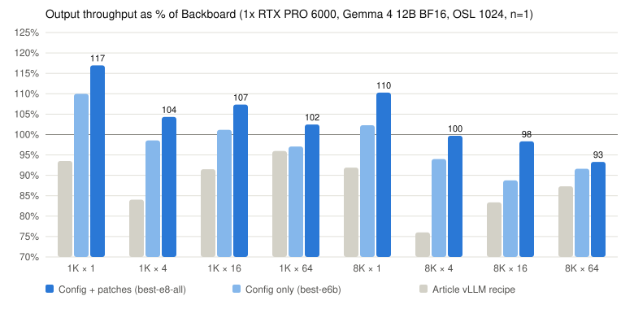

# gemma4-inference-repro

An independent, open-source attempt to **reproduce** the Gemma 4 12B serving benchmark that Backboard published on
2026-11-09 ([article](https://backboard.io/blog/gemma-4-12b-vllm-sglang-inference)), and then to get as close as
possible to Backboard's proprietary engine with an open engine (vLLM 0.33.0 plus small, documented patches).

Setup throughout: 1× NVIDIA RTX PRO 6000 Blackwell Server Edition (96 GB, 600 W) on Modal, `google/gemma-4-12B-it`
BF16 with the `google/gemma-4-12B-it-assistant` MTP draft, random-token prompts (InferenceX client, range ratio 0.8,
chat template), 1024 output tokens, input length 1K / 8K × concurrency 1 / 4 / 16 / 64.

> **Read this first.** Backboard's figures are single published values from unstated hardware, so every comparison
> with Backboard here is **descriptive**, not a pre-registered "beats". The strongest evidence is the **same-GPU paired**
> measurement below: the article's own vLLM recipe and our configuration run interleaved on one GPU, which cancels
> Modal's 5–15 % GPU-to-GPU spread, and the speed-up is then scaled by the article's published vLLM numbers. An
> independent adversarial review of these claims is summarised in [Caveats](#caveats).

## Results at a glance



| | Result |
|---|---|
| **Article baselines reproduced** | vLLM 0.33.0 within **+0.9 … +3.1 %** of the article at **8/8** workloads; SGLang 0.5.23 runs **7–17 % faster** than the article's |
| **Same GPU, one config, all 8 workloads** (`vllm-0.33.0-best-e8-pfa2-c8k` vs the article recipe, interleaved) | **1.07–1.33× the article's vLLM recipe** at every workload; scaled to Backboard: **≈ 105 % geometric mean, 99–114 % per workload** (8K × 4 ≈ 99 %, 8K × 64 ≈ 100 %) |
| **Earlier, across GPUs** (`vllm-0.33.0-best-e8-all`, n = 3) | **102.1 %** of Backboard's published throughput (geometric mean): 102–115 % at 1K, 89–108 % at 8K; **8K × 64 is a significant shortfall (89 %, CI 80–98 %)** |
| **Outputs** | greedy equivalence vs a BF16 no-speculation reference (8 prompts up to 7.9K tokens): every divergence of every config, the article's own recipe included, is a near-tie (top-2 within 0.25 nats); bitwise identity is impossible with speculative decoding in vLLM (D-063) |
| **Not verified** | latency: p90 TTFT is worse than Backboard's at several points |
| **Configuration only** (`vllm-0.33.0-best-e6b`, no engine patches) | ≥ 95 % of Backboard at 5/8, geometric mean 97.7 % |
| **Biggest wins** | split-K attention for Gemma 4's head-dim-512 layers (+8 % at 8K/c4); FP8 draft-head scan with exact BF16 rescoring (Backboard's disclosed idea); per-layer-group split-K thresholds; a custom prefill-attention kernel (−40 % prefill attention, +5 % at 8K × 64) |
| **What is left** | more same-GPU pairs (1–2 per workload so far) rotated across GPUs; latency; BF16 GEMMs on this GPU already run at its practical limit |
| **Cost** | ≈ **$36** of Modal compute in total (every launch in [`results/budget_ledger.jsonl`](results/budget_ledger.jsonl)) |

### 1. Reproducing the article's open-engine baselines

Output throughput (tok/s), our run vs the article, same recipes (vLLM MTP 4 tokens; SGLang NEXTN 5 steps / 6 tokens):

| Workload | vLLM ours | vLLM article | Δ | SGLang ours | SGLang article | Δ |
|---|---:|---:|---:|---:|---:|---:|
| 1K × 1 | 190.4 | 186.8 | +1.9 % | 136.9 | 122.6 | +11.7 % |
| 1K × 4 | 655.0 | 649.0 | +0.9 % | 499.1 | 456.8 | +9.3 % |
| 1K × 16 | 1905 | 1861 | +2.4 % | 1299 | 1122 | +15.8 % |
| 1K × 64 | 3668 | 3634 | +0.9 % | 2039 | 1750 | +16.5 % ¹ |
| 8K × 1 | 164.6 | 159.6 | +3.1 % | 89.4 | 82.5 | +8.4 % |
| 8K × 4 | 402.6 | 395.7 | +1.8 % | 287.9 | 269.5 | +6.8 % |
| 8K × 16 | 801.9 | 794.5 | +0.9 % | 587.5 | 533.7 | +10.1 % |
| 8K × 64 | 1095 | 1079 | +1.5 % | 728.6 | 673.6 | +8.2 % ¹ |

vLLM's latencies (p99 TPOT, p99 E2EL, p90 TTFT) land at 0.82–1.11× the article's. ¹ SGLang auto-capped itself
at 48 running requests, so its c64 points queue (TTFT 5–20 s); a like-for-like config (`sglang-0.5.23-nextn-fair64`)
is prepared but not run.

### 2. Comparison with Backboard's published numbers

What we did and did not establish:

- **Same-GPU paired throughput** (D-061, D-065, `results/pairs/`): in one container on one GPU, a fresh server for the
  article's recipe (`vllm-0.33.0-mtp4`, A) and one for ours (`vllm-0.33.0-best-e8-pfa2-c8k`, B), interleaved ABBA /
  BAAB. Backboard estimate = (B / A) × (article vLLM / Backboard). One frozen configuration for all eight workloads:

| Workload | Pairs | A (article recipe) | B (ours) | B / A | Est. vs Backboard | B vs Backboard, absolute |
|---|---:|---:|---:|---:|---:|---:|
| 1K × 1 | 2 | 189.6 | 234.8 | 1.239 | **1.14** | 115 % |
| 1K × 4 | 2 | 654.2 | 828.8 | 1.267 | **1.05** | 106 % |
| 1K × 16 | 2 | 1890 | 2234 | 1.182 | **1.06** | 107 % |
| 1K × 64 | 2 | 3660 | 3932 | 1.074 | **1.02** | 103 % |
| 8K × 1 | 2 | 162.2 | 206.2 | 1.272 | **1.13** | 115 % |
| 8K × 4 | 2 | 400.6 | 531.1 | 1.326 | **0.99** | 100 % |
| 8K × 16 | 2 | 805.8 | 1013 | 1.257 | **1.04** | 105 % |
| 8K × 64 | 1 | 1092 | 1268 | 1.162 | **1.00** | 101 % |

  Geometric mean of the estimates **1.053**. The two pairs at each point agree within 0.1–0.8 %, so the remaining
  uncertainty is not measurement noise but the estimator itself: it trusts the article's single vLLM figure per point
  and Backboard's single figure. At 8K × 4 and 8K × 64 the honest reading is **parity**, not a win.

- **Earlier, across GPUs** (`vllm-0.33.0-best-e8-all`, n = 3 runs on different Modal GPUs,
  Student-t 95 % CI of *our* run-to-run spread — Backboard's own variance and hardware are unknown):

| Workload | Backboard | Ours (mean, n = 3) | % of Backboard | 95 % CI (ours) |
|---|---:|---:|---:|---|
| 1K × 1 | 203.6 | 234.8 | 115 % | 112–119 % |
| 1K × 4 | 779.4 | 815.2 | 105 % | 104–106 % |
| 1K × 16 | 2082 | 2207 | 106 % | 103–109 % |
| 1K × 64 | 3822 | 3917 | 102 % | 102–103 % |
| 8K × 1 | 179.1 | 193.5 | 108 % | 97–119 % |
| 8K × 4 | 529.6 | 507.9 | 96 % | 87–105 % |
| 8K × 16 | 961.8 | 941.0 | 98 % | 95–101 % |
| 8K × 64 | 1254 | 1115.6 | **89 %** | **80–98 %** |

  Geometric mean **102.1 %**. The 1K margins (+2.5 … +15 %) are of the same order as our environment's offset on the
  article's own vLLM recipe (+0.9 … +3.1 %), so the smallest of them may not survive a hardware-matched comparison.
- **Custom prefill attention** (`best-e8-pfa-c8k`, added later and chosen per workload): 8K × 4 98.5 % (n = 2,
  CI 66–131 %), 8K × 16 103 % (n = 2, CI 87–119 %), 8K × 64 95.8 % (n = 3, CI 85–106 %; 94.1 % without the seed-0
  run used to select it). Not run at 1K or 8K × 1.
- **Latency is not better everywhere.** At 8K × 1 (108 % throughput) our p99 TPOT, p99 E2EL and p90 TTFT are all
  worse than Backboard's (e.g. p90 TTFT 667–703 ms vs 549); p90 TTFT is also worse at several 1K points. Backboard
  reports 13 metrics per point; this repo compares output throughput only.
- **Output equivalence: near-ties only** (D-063). Against a BF16 no-speculation greedy reference (8 prompts, 4 of them
  3K–8K tokens, 256 output tokens), the article's own recipe matches 4/8 and ours 3–4/8; every first divergence, for
  every config, is at a position where the reference's top-2 tokens are within 0.25 nats. The custom kernels, cuBLAS
  13.10 and chunk size change the target's arithmetic only at that level. The draft head runs as an FP8 scan with
  BF16 rescoring (class b, D-011), the same category as Backboard's disclosed "4-bit shortlist".

**Single-run progression** (seed 0, one config across all eight workloads, tok/s):

| Workload | Backboard | Article vLLM recipe | Config only (`best-e6b`) | + engine patches (`best-e8-all`) | + prefill kernel (`best-e8-pfa`) |
|---|---:|---:|---:|---:|---:|
| 1K × 1 | 203.6 | 190.4 | 223.9 | 238.1 | – |
| 1K × 4 | 779.4 | 655.0 | 768.1 | 813.1 | – |
| 1K × 16 | 2082 | 1905 | 2106 | 2235 | – |
| 1K × 64 | 3822 | 3668 | 3710 | 3916 | – |
| 8K × 1 | 179.1 | 164.6 | 183.2 | 197.5 | – |
| 8K × 4 | 529.6 | 402.6 | 497.8 | 528.0 | 525.2 |
| 8K × 16 | 961.8 | 801.9 | 853.9 | 945.8 | 986.0 |
| 8K × 64 | 1254 | 1095 | 1149 | 1170 | 1226 |

**What moved the needle** (details and run IDs in [docs/DECISIONS.md](docs/DECISIONS.md)):

| Change | Effect | Ref |
|---|---|---|
| Speculative depth 6 instead of 4 (acceptance 4.05 → 4.99) | +8 % at 8K/c4 (n = 2, ±1 %) | D-042 |
| CUDA-graph capture sizes `1 2 28 32 …` keep vLLM's Triton **split-K** attention on for 4 requests × 7 tokens (Gemma 4's 8 global layers: 1 KV head, head dim 512) | +8.4 % at 8K/c4, median token gap −12 % | D-044 |
| Patched vLLM: Gemma 4 MTP **draft prefill on the last token only** (the draft is KV-shared and row-wise) | +2.6 % at 8K/c16, −3.6 % 8K TTFT | D-046 |
| Depth by batch size: 6 up to 32 running requests, 4 above | +3 % at 1K/c64; with the draft patch, 8K/c64 1098 → 1149 | D-047 |
| 3072-token prefill chunks | p99 inter-token gap 584 → 274 ms; +1.4 % throughput | D-043 |
| Patched vLLM: **FP8 draft-head scan + exact BF16 rescore** (the 12B drafter scores all 262 144 tokens in BF16 every draft step) | head 395 → 210 µs per draft step; acceptance unchanged (5.25 at 8K/c4) | D-054 |
| Patched vLLM: **split-K threshold per attention group** (global and sliding layers want opposite kernels) | attention −3.4 ms/forward at 8K/c16 | D-053 |
| cuBLAS 13.10 instead of the image's 13.1 | −2 to −3 % per forward on every GEMM size | D-052 |
| Patched vLLM: **custom prefill attention** (FlashAttention-2-style, packs the 16 query heads that share Gemma 4's single global KV head; sliding-window variant) | prefill attention per 8K prompt 190 → 114 ms; 8K × 16 +4 %, 8K × 64 +5 % | D-059 |
| Prefill attention **v2** in Gluon for sm_120's `mma.sync` (~190 TFLOPS) plus 8192-token chunks | prefill attention per 8K prompt 114 → 73 ms | D-064 |

**What did not:** patched Triton prefill tiles for sm_120 (no change), depth 5 (never best), depth 7+ (breaks split-K
at c4). Ruled out from source without a GPU run: FlashInfer (no fast path for head dim 512 on sm_120), draft LM-head
quantization (vLLM rejects it for Gemma 4 MTP), partial-prefill flags (absent in v0.33.0).

### 3. Kernel lab: where the time goes on sm_120

`g4bench modal script --path kernels/<bench>.py --execute` runs micro-benchmarks on the same GPU inside the pinned
image (results in [`results/kernels/`](results/kernels/), cents per run):

- **GEMMs are at the hardware limit.** With cold weights, decode linears take 15.8 ms per forward at 28 tokens vs a
  14.9 ms weight-read floor (1.46 TB/s); prefill shapes run at 341–427 TFLOPS vs a measured ~415–440 peak.
  `torch.compile` max-autotune and the CUTLASS CuTe-DSL sm_120 GEMM never beat cuBLAS; cuBLAS 13.10 is 2–3 % faster.
- **Attention:** for decode, a packed-row verify kernel saves only ~0.5 ms at 8K/c4 (repeat KV reads hit the 128 MB
  L2), but vLLM's single split-K threshold picks the wrong kernel for one of Gemma 4's two layer types at c16/c64.
  For prefill, vLLM's generic Triton kernel ran at 57–90 TFLOPS; our packed-head kernel reaches 100–137 TFLOPS.
- **Draft head:** the quantized scan reads 4× (INT4) or 2× (FP8) fewer bytes; FP8 is shipped for its higher recall.
- **Stronger drafters:** DeepSeek's DSpark block-7 drafter is slower on random-token prompts (no acceptance gain).

**Where the rest of the gap is.** At 8K the remaining difference to Backboard is smaller than the run-to-run spread
between Modal GPUs. Prefill GEMMs are already at peak; prefill attention still has headroom (≈ 130 TFLOPS vs ≈ 400 for
GEMMs), which is the most promising next kernel.

## How it works

```
g4bench modal spend                       # free: committed spend vs the cap, reconciled with Modal billing
g4bench modal prefetch --execute          # CPU (~$0.01): pinned weights into a Modal Volume
g4bench modal job --engine vllm-0.33.0-best-e8-all --matrix backboard-repro-shared --only 8192x4            # plan only
g4bench modal job --engine vllm-0.33.0-best-e8-all --matrix backboard-repro-shared --only 8192x4 --execute  # run it
g4bench modal script --path kernels/gemm_bench.py --execute   # kernel micro-benchmark on the GPU
g4bench modal job ... --profile-key 8192x4 --execute   # torch-profiler summary of one point
g4bench analyze && g4bench claims         # aggregate results/runs → results/summary, docs/CLAIMS.md
```

- **Paid runs go straight to Modal** from your machine (credentials in an untracked `.env`), one ephemeral app per
  launch, nothing left deployed. Engine images are digest-pinned (vLLM v0.33.0, SGLang v0.5.23). A separate patched
  vLLM image carries build-time patches (`src/g4bench/patches/`: anchored, idempotent, opt-in per config) plus
  cuBLAS 13.10; every run records which patches and settings were active.
- **Spend gate** (`src/g4bench/spend.py`): before every launch the worst case (container limits × timeout + margins)
  must fit a per-job and a project cap; the Modal timeout is derived from the reservation, and every launch is
  reconciled against Modal's per-app bill.
- **Every run** writes `results/runs/<run_id>/` with raw InferenceX output, server logs, effective engine config,
  speculative-decoding counters, GPU samples, correctness probes and a `REPORT.md`. Mock, proxy-hardware, profiled
  and non-article-length runs are never compared with the article.

## Quick start (CPU)

```bash
scripts/setup.sh            # venv from requirements-lock.txt, pinned-revision check, engine-flag preflight, tests
```

The harness targets Linux (the GPU images run Python 3.12). On Windows a few process-group tests fail by design;
`g4bench modal selftest --execute` runs the full suite on Linux inside Modal for about a cent.

## Repository layout

```
configs/engines/        engine configs: article baselines (role: baseline) and every experiment (role: variant)
configs/matrix/         workload matrices (article matrix, shared-server variant, smoke, real-prompt arms)
configs/targets/        the article's published numbers, transcribed and test-checked
src/g4bench/            harness: runner, InferenceX client, stats, analysis, Modal app + launcher, spend gate,
                        engine patches (patches/), profiler summaries
kernels/                GPU micro-benchmarks (GEMM, cuBLAS versions, CuTe DSL, attention, draft-head scan)
results/runs/           every measured run, raw and normalized
results/kernels/        micro-benchmark outputs
results/summary/        aggregated tables (SUMMARY.md, best_vs_backboard.csv, …)
docs/                   DECISIONS.md (decision log D-001…D-056), EXPERIMENTS.md (pre-registered plan and run log),
                        CLAIMS.md, SOURCES.md, analysis/
third_party/inferencex/ vendored InferenceX bench_serving @ 0b991451 (Apache-2.0)
```

## Caveats

From an independent adversarial review of the comparison (2026-11-13):

- **Output equivalence is weaker than pre-registered.** The greedy gate now runs (D-063), but exact token identity is
  impossible for any speculative config, the article's included; the amended near-tie criterion was set after seeing
  that, and 8 prompts is a small set.
- **Selection after the fact.** About 18 engine configurations were tried; the paired table uses one frozen
  configuration for all eight workloads, but that configuration was itself chosen on earlier 8K runs.
- **Hardware not matched.** The article does not state its GPU edition, power limit or driver. Modal GPUs vary by
  7–15 % at 8K (runs at ~2,200 MHz / ~520 W vs ~2,370 MHz / ~570 W); the confidence intervals mix GPUs and cover only
  our spread, not Backboard's. The paired runs cancel this for ours vs the article recipe, but the step to Backboard
  still assumes the article's vLLM and Backboard figures came from comparable hardware. Our environment also runs the article's SGLang recipe 7–17 % faster than published.
- **Workload assumptions the article does not state:** random-token prompts, range ratio 0.8, ignore-EOS, 10 requests
  per unit of concurrency (only 10 measured requests at c1), 8 warm-ups. Random tokens may inflate draft acceptance.
  Points in one job share a server start, whereas the article uses a fresh server per point.
- **Provenance:** about half of the runs before 2026-11-13 lack the code SHA in their metadata; later runs record it.
- **To settle it:** ≥ 5 same-GPU pairs per workload rotated across GPUs; report latency alongside throughput. A direct
  same-GPU run of Backboard's engine is not possible (it is proprietary).

Licence: not yet chosen. `third_party/inferencex` keeps its upstream Apache-2.0 licence and notice.
