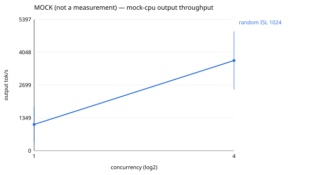

# Run report: `20261110T203947Z-mock-cpu-cpu-5dddc43b-9a4f`

> **MOCK ENGINE — NOT A MEASUREMENT.** CPU fake server used to test the harness. Numbers below describe the mock, not any GPU or inference engine.

## Identity

- engine config: `mock-cpu` (mock 0)
- config hash: `5dddc43bfc0a`
- hardware: `cpu`; exact article hardware: **False**
- GPU: none (CPU)
- git: `c744768d29c3db9aac378f082b9cd0a378990f5f` dirty=False
- point-runs: 4 total, 4 valid

<details><summary>server argv</summary>

```
/home/user/gemma4-inference-repro/.venv/bin/python3 -m g4bench.mockserver --model google/gemma-4-12B-it --port 18000 --step-ms 1.0 --tokens-per-step 3
```
</details>

## Throughput vs concurrency

Mean over valid seeds/trials in this run; CI = Student-t 95 % across runs (needs n ≥ 2). Little's-law column is a within-run diagnostic from per-request logs.

| dataset | ISL | conc | n | output tok/s | 95% CI | tok/s/user | Little's-law tok/s (gap) |
|---|---:|---:|---:|---:|---|---:|---|
| random | 1024 | 1 | 2 | 1079 | [341, 1817] | 2565 | 1090 (+1.0%) |
| random | 1024 | 4 | 2 | 3709 | [2511, 4907] | 1966 | 4024 (+8.5%) |



## Latency (ms, mean over runs of each run's statistic)

| dataset | ISL | conc | TTFT mean | TTFT p90 | TTFT p99 | TPOT mean | TPOT p99 | E2EL mean | E2EL p99 |
|---|---:|---:|---:|---:|---:|---:|---:|---:|---:|
| random | 1024 | 1 | 30.21 | 30.97 | 31.15 | 0.3899 | 0.3948 | 51.85 | 53.63 |
| random | 1024 | 4 | 28.17 | 34.3 | 35.35 | 0.5114 | 0.5898 | 57.12 | 67.64 |

## Speculative decoding acceptance & resources

| dataset | ISL | conc | acceptance length | peak GPU MiB | mean GPU W |
|---|---:|---:|---:|---:|---:|
| random | 1024 | 1 | 2.965 | not measured | not measured |
| random | 1024 | 4 | 2.969 | not measured | not measured |

## Comparison with article baselines

Not compared: mock engine.

## Correctness gate

Known-answer probes: 8/8 — PASS; greedy outputs captured: 8

## Invalid / skipped point-runs

None.
