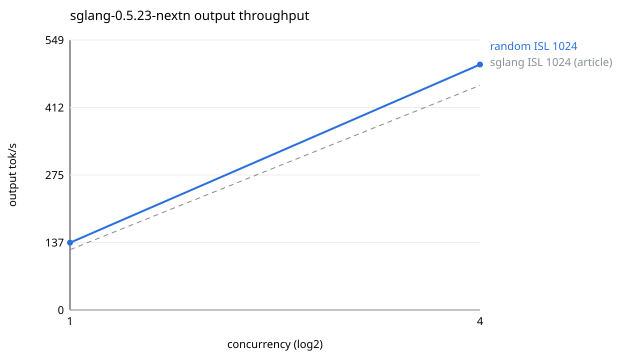

# Run report: `20261111T014200Z-sglang-0.5.23-nextn-rtx-pro-6000-sex1-7cbf3a7a-90cf`

## Identity

- engine config: `sglang-0.5.23-nextn` (sglang 0.5.23)
- config hash: `7cbf3a7a62fe`
- hardware: `RTX-PRO-6000-SEx1`; exact article hardware: **True**
- GPU: NVIDIA RTX PRO 6000 Blackwell Server Edition / power limit 600.00 W / driver 610.57.04
- git: `a952595ad7366f8ae0ada46306122567e6a68d28` dirty=True
- point-runs: 2 total, 2 valid

<details><summary>server argv</summary>

```
python3 -m sglang.launch_server --model-path google/gemma-4-12B-it --revision 43c9d014b231474fa7212dbb48a762566c2b255d --tp-size 1 --dtype bfloat16 --speculative-algorithm NEXTN --speculative-draft-model-path google/gemma-4-12B-it-assistant --speculative-draft-model-revision 3b0b0a4a3b31b5556516329227fb55f275c23c9f --speculative-num-steps 5 --speculative-num-draft-tokens 6 --speculative-eagle-topk 1 --mem-fraction-static 0.85 --disable-radix-cache --host 0.0.0.0 --port 30000
```
</details>

## Throughput vs concurrency

Mean over valid seeds/trials in this run; CI = Student-t 95 % across runs (needs n ≥ 2). Little's-law column is a within-run diagnostic from per-request logs.

| dataset | ISL | conc | n | output tok/s | 95% CI | tok/s/user | Little's-law tok/s (gap) |
|---|---:|---:|---:|---:|---|---:|---|
| random | 1024 | 1 | 1 | 136.9 | n<2 | 139.1 | 137 (+0.0%) |
| random | 1024 | 4 | 1 | 499.1 | n<2 | 130.3 | 510.3 (+2.2%) |



## Latency (ms, mean over runs of each run's statistic)

| dataset | ISL | conc | TTFT mean | TTFT p90 | TTFT p99 | TPOT mean | TPOT p99 | E2EL mean | E2EL p99 |
|---|---:|---:|---:|---:|---:|---:|---:|---:|---:|
| random | 1024 | 1 | 108.7 | 118.8 | 121.6 | 7.187 | 7.495 | 6728 | 7603 |
| random | 1024 | 4 | 171.5 | 248.7 | 294.2 | 7.674 | 9.276 | 7194 | 8223 |

## Speculative decoding acceptance & resources

| dataset | ISL | conc | acceptance length | peak GPU MiB | mean GPU W |
|---|---:|---:|---:|---:|---:|
| random | 1024 | 1 | 4.864 | 77058 | 271 |
| random | 1024 | 4 | 4.610 | 77392 | 298 |

## Effective engine configuration (parsed from server logs)

| attention backend | spec algorithm | KV-cache tokens | max running requests | seen in |
|---|---|---:|---:|---|
| triton | FROZEN_KV_MTP | 1,074,415 | 48 | 2 point-run(s) |

## Comparison with article baselines

Config role: **baseline**, admissibility class **a** (DECISIONS D-011).
Reference: article `sglang` (and Backboard) numbers for random-token prompts. Classification uses the pre-registered 5 % tolerance (EXPERIMENTS.md); n<3 results are descriptive only.

| ISL | conc | ours | n | article sglang | ours/article | class | article Backboard | ours/Backboard |
|---:|---:|---:|---:|---:|---:|---|---:|---:|
| 1024 | 1 | 136.9 | 1 | 122.6 | 1.117 | higher | 203.6 | 0.673 |
| 1024 | 4 | 499.1 | 1 | 456.8 | 1.093 | higher | 779.4 | 0.640 |

## Gap attribution (first-order; acceptance vs step speed)

Assumptions: first-order: TPOT = step/AL; mean TPOT; AL incl. bonus token; batch = conc; ctx = ISL + OSL/2; roofline at 85% of peak HBM/GDDR bandwidth. Article mean TPOT = 1000 / its 'speed per user'.

| ISL | conc | our TPOT ms | our AL | step ms | BW eff. | AL needed for article sglang | for Backboard | step speed-up needed (Backboard) |
|---:|---:|---:|---:|---:|---:|---:|---:|---:|
| 1024 | 1 | 7.19 | 4.86 | 35 | 0.49 | 4.27 | 7.14 (> max AL) | 1.47x |
| 1024 | 4 | 7.67 | 4.61 | 35.4 | 0.51 | 4.26 | 7.22 (> max AL) | 1.57x |

## Correctness gate

Known-answer probes: 8/8 — PASS; greedy outputs captured: 8

## Invalid / skipped point-runs

None.
