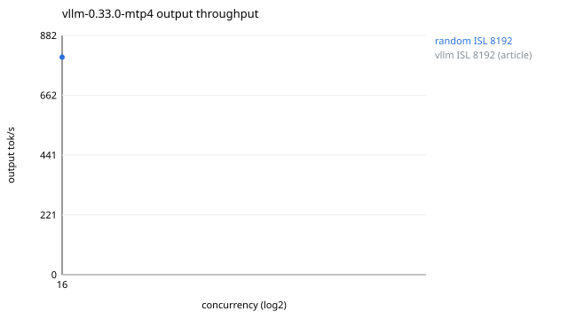

# Run report: `20261111T020537Z-vllm-0.33.0-mtp4-rtx-pro-6000-sex1-28818286-7e13`

## Identity

- engine config: `vllm-0.33.0-mtp4` (vllm 0.33.0)
- config hash: `288182863c19`
- hardware: `RTX-PRO-6000-SEx1`; exact article hardware: **True**
- GPU: NVIDIA RTX PRO 6000 Blackwell Server Edition / power limit 600.00 W / driver 610.57.04
- git: `8b11b0be166535ed92ccecab4ce123c103ef33a5` dirty=True
- point-runs: 1 total, 1 valid

<details><summary>server argv</summary>

```
vllm serve google/gemma-4-12B-it --revision 43c9d014b231474fa7212dbb48a762566c2b255d --tensor-parallel-size 1 --dtype bfloat16 --gpu-memory-utilization 0.90 --no-enable-prefix-caching --async-scheduling --speculative-config {"method":"mtp","model":"google/gemma-4-12B-it-assistant","revision":"3b0b0a4a3b31b5556516329227fb55f275c23c9f","num_speculative_tokens":4} --host 0.0.0.0 --port 8000
```
</details>

## Throughput vs concurrency

Mean over valid seeds/trials in this run; CI = Student-t 95 % across runs (needs n ≥ 2). Little's-law column is a within-run diagnostic from per-request logs.

| dataset | ISL | conc | n | output tok/s | 95% CI | tok/s/user | Little's-law tok/s (gap) |
|---|---:|---:|---:|---:|---|---:|---|
| random | 8192 | 16 | 1 | 801.9 | n<2 | 55.76 | 825.8 (+3.0%) |



## Latency (ms, mean over runs of each run's statistic)

| dataset | ISL | conc | TTFT mean | TTFT p90 | TTFT p99 | TPOT mean | TPOT p99 | E2EL mean | E2EL p99 |
|---|---:|---:|---:|---:|---:|---:|---:|---:|---:|
| random | 8192 | 16 | 1321 | 1942 | 9297 | 17.93 | 29.12 | 1.773e+04 | 2.847e+04 |

## Speculative decoding acceptance & resources

| dataset | ISL | conc | acceptance length | peak GPU MiB | mean GPU W |
|---|---:|---:|---:|---:|---:|
| random | 8192 | 16 | 4.094 | 87410 | 495 |

## Effective engine configuration (parsed from server logs)

| attention backend | spec algorithm | KV-cache tokens | max running requests | seen in |
|---|---|---:|---:|---|
| AttentionBackendEnum.TRITON_ATTN | not measured | 1,568,055 | not measured | 1 point-run(s) |

## Comparison with article baselines

Config role: **baseline**, admissibility class **a** (DECISIONS D-011).
Reference: article `vllm` (and Backboard) numbers for random-token prompts. Classification uses the pre-registered 5 % tolerance (EXPERIMENTS.md); n<3 results are descriptive only.

| ISL | conc | ours | n | article vllm | ours/article | class | article Backboard | ours/Backboard |
|---:|---:|---:|---:|---:|---:|---|---:|---:|
| 8192 | 16 | 801.9 | 1 | 794.5 | 1.009 | consistent | 961.8 | 0.834 |

## Gap attribution (first-order; acceptance vs step speed)

Assumptions: first-order: TPOT = step/AL; mean TPOT; AL incl. bonus token; batch = conc; ctx = ISL + OSL/2; roofline at 85% of peak HBM/GDDR bandwidth. Article mean TPOT = 1000 / its 'speed per user'.

| ISL | conc | our TPOT ms | our AL | step ms | BW eff. | AL needed for article vllm | for Backboard | step speed-up needed (Backboard) |
|---:|---:|---:|---:|---:|---:|---:|---:|---:|
| 8192 | 16 | 17.9 | 4.09 | 73.4 | 0.30 | 4.13 | 4.99 | 1.22x |

## Correctness gate

Known-answer probes: 8/8 — PASS; greedy outputs captured: 8

## Invalid / skipped point-runs

None.
