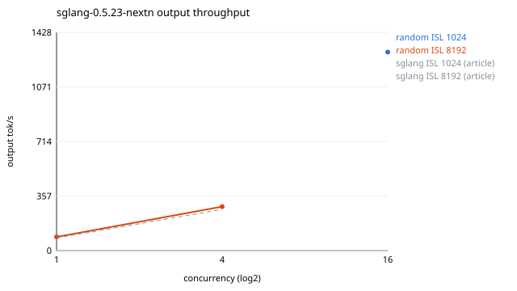

# Run report: `20261111T021211Z-sglang-0.5.23-nextn-rtx-pro-6000-sex1-7cbf3a7a-0853`

## Identity

- engine config: `sglang-0.5.23-nextn` (sglang 0.5.23)
- config hash: `7cbf3a7a62fe`
- hardware: `RTX-PRO-6000-SEx1`; exact article hardware: **True**
- GPU: NVIDIA RTX PRO 6000 Blackwell Server Edition / power limit 600.00 W / driver 610.57.04
- git: `8b11b0be166535ed92ccecab4ce123c103ef33a5` dirty=True
- point-runs: 3 total, 3 valid

<details><summary>server argv</summary>

```
python3 -m sglang.launch_server --model-path google/gemma-4-12B-it --revision 43c9d014b231474fa7212dbb48a762566c2b255d --tp-size 1 --dtype bfloat16 --speculative-algorithm NEXTN --speculative-draft-model-path google/gemma-4-12B-it-assistant --speculative-draft-model-revision 3b0b0a4a3b31b5556516329227fb55f275c23c9f --speculative-num-steps 5 --speculative-num-draft-tokens 6 --speculative-eagle-topk 1 --mem-fraction-static 0.85 --disable-radix-cache --host 0.0.0.0 --port 30000
```
</details>

## Throughput vs concurrency

Mean over valid seeds/trials in this run; CI = Student-t 95 % across runs (needs n ≥ 2). Little's-law column is a within-run diagnostic from per-request logs.

| dataset | ISL | conc | n | output tok/s | 95% CI | tok/s/user | Little's-law tok/s (gap) |
|---|---:|---:|---:|---:|---|---:|---|
| random | 1024 | 16 | 1 | 1299 | n<2 | 86.31 | 1348 (+3.8%) |
| random | 8192 | 1 | 1 | 89.42 | n<2 | 95.28 | 89.43 (+0.0%) |
| random | 8192 | 4 | 1 | 287.9 | n<2 | 79.95 | 298.3 (+3.6%) |



## Latency (ms, mean over runs of each run's statistic)

| dataset | ISL | conc | TTFT mean | TTFT p90 | TTFT p99 | TPOT mean | TPOT p99 | E2EL mean | E2EL p99 |
|---|---:|---:|---:|---:|---:|---:|---:|---:|---:|
| random | 1024 | 16 | 278 | 623.6 | 1047 | 11.59 | 15.06 | 1.088e+04 | 1.496e+04 |
| random | 8192 | 1 | 634.4 | 665.7 | 672.1 | 10.5 | 15.5 | 1.04e+04 | 1.55e+04 |
| random | 8192 | 4 | 847.5 | 1266 | 2454 | 12.51 | 19.31 | 1.234e+04 | 1.888e+04 |

## Speculative decoding acceptance & resources

| dataset | ISL | conc | acceptance length | peak GPU MiB | mean GPU W |
|---|---:|---:|---:|---:|---:|
| random | 1024 | 16 | 4.726 | 78345 | 349 |
| random | 8192 | 1 | 4.469 | 78345 | 238 |
| random | 8192 | 4 | 4.513 | 78345 | 310 |

## Effective engine configuration (parsed from server logs)

| attention backend | spec algorithm | KV-cache tokens | max running requests | seen in |
|---|---|---:|---:|---|
| triton | FROZEN_KV_MTP | 1,074,157 | 48 | 3 point-run(s) |

## Comparison with article baselines

Config role: **baseline**, admissibility class **a** (DECISIONS D-011).
Reference: article `sglang` (and Backboard) numbers for random-token prompts. Classification uses the pre-registered 5 % tolerance (EXPERIMENTS.md); n<3 results are descriptive only.

| ISL | conc | ours | n | article sglang | ours/article | class | article Backboard | ours/Backboard |
|---:|---:|---:|---:|---:|---:|---|---:|---:|
| 1024 | 16 | 1299 | 1 | 1122 | 1.157 | higher | 2082 | 0.624 |
| 8192 | 1 | 89.42 | 1 | 82.5 | 1.084 | higher | 179.1 | 0.499 |
| 8192 | 4 | 287.9 | 1 | 269.5 | 1.068 | higher | 529.6 | 0.544 |

## Gap attribution (first-order; acceptance vs step speed)

Assumptions: first-order: TPOT = step/AL; mean TPOT; AL incl. bonus token; batch = conc; ctx = ISL + OSL/2; roofline at 85% of peak HBM/GDDR bandwidth. Article mean TPOT = 1000 / its 'speed per user'.

| ISL | conc | our TPOT ms | our AL | step ms | BW eff. | AL needed for article sglang | for Backboard | step speed-up needed (Backboard) |
|---:|---:|---:|---:|---:|---:|---:|---:|---:|
| 1024 | 16 | 11.6 | 4.73 | 54.8 | 0.40 | 4.08 | 7.50 (> max AL) | 1.59x |
| 8192 | 1 | 10.5 | 4.47 | 46.9 | 0.36 | 4.23 | 9.57 (> max AL) | 2.14x |
| 8192 | 4 | 12.5 | 4.51 | 56.5 | 0.32 | 4.48 | 8.96 (> max AL) | 1.99x |

## Correctness gate

Known-answer probes: 8/8 — PASS; greedy outputs captured: 8

## Invalid / skipped point-runs

None.
