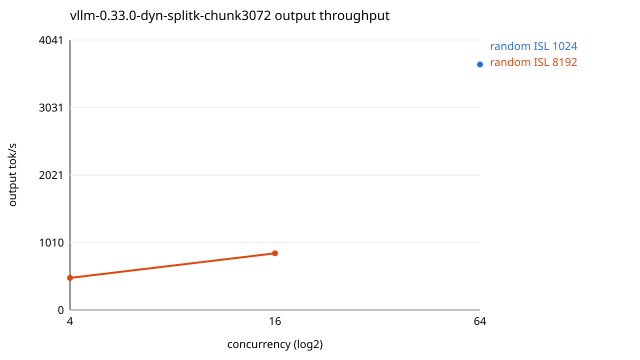

# Run report: `20261111T151542Z-vllm-0.33.0-dyn-splitk-chunk3072-rtx-pro-6000-sex1-86d3fd61-85e7`

## Identity

- engine config: `vllm-0.33.0-dyn-splitk-chunk3072` (vllm 0.33.0)
- config hash: `86d3fd617c5d`
- hardware: `RTX-PRO-6000-SEx1`; exact article hardware: **True**
- GPU: NVIDIA RTX PRO 6000 Blackwell Server Edition / power limit 600.00 W / driver 610.57.04
- git: `9edd3f68fdf9ab8314df82b77c6b484abfa65fe6` dirty=False
- point-runs: 3 total, 3 valid

<details><summary>server argv</summary>

```
vllm serve google/gemma-4-12B-it --revision 43c9d014b231474fa7212dbb48a762566c2b255d --tensor-parallel-size 1 --dtype bfloat16 --gpu-memory-utilization 0.90 --no-enable-prefix-caching --async-scheduling --speculative-config {"method":"mtp","model":"google/gemma-4-12B-it-assistant","revision":"3b0b0a4a3b31b5556516329227fb55f275c23c9f","num_speculative_tokens":6,"num_speculative_tokens_per_batch_size":[[1,8,6],[9,24,5],[25,4096,4]]} --max-num-batched-tokens 3072 --cudagraph-capture-sizes 1 2 28 32 40 48 56 64 72 80 88 96 104 112 120 128 136 144 152 160 168 176 184 192 200 208 216 224 232 240 248 256 272 280 288 304 320 336 352 368 384 392 400 416 432 448 464 480 496 504 512 --host 0.0.0.0 --port 8000
```
</details>

## Throughput vs concurrency

Mean over valid seeds/trials in this run; CI = Student-t 95 % across runs (needs n ≥ 2). Little's-law column is a within-run diagnostic from per-request logs.

| dataset | ISL | conc | n | output tok/s | 95% CI | tok/s/user | Little's-law tok/s (gap) |
|---|---:|---:|---:|---:|---|---:|---|
| random | 1024 | 64 | 1 | 3674 | n<2 | 60.58 | 3753 (+2.1%) |
| random | 8192 | 4 | 1 | 481 | n<2 | 139.7 | 493.4 (+2.6%) |
| random | 8192 | 16 | 1 | 848.3 | n<2 | 59.64 | 869.1 (+2.5%) |



## Latency (ms, mean over runs of each run's statistic)

| dataset | ISL | conc | TTFT mean | TTFT p90 | TTFT p99 | TPOT mean | TPOT p99 | E2EL mean | E2EL p99 |
|---|---:|---:|---:|---:|---:|---:|---:|---:|---:|
| random | 1024 | 64 | 522.6 | 687.8 | 4286 | 16.51 | 20.37 | 1.572e+04 | 2.087e+04 |
| random | 8192 | 4 | 885.5 | 1322 | 2378 | 7.158 | 11.01 | 7459 | 1.138e+04 |
| random | 8192 | 16 | 1512 | 2171 | 9568 | 16.77 | 29.03 | 1.685e+04 | 2.762e+04 |

## Speculative decoding acceptance & resources

| dataset | ISL | conc | acceptance length | peak GPU MiB | mean GPU W |
|---|---:|---:|---:|---:|---:|
| random | 1024 | 64 | 4.192 | 87512 | 523 |
| random | 8192 | 4 | 5.054 | 87512 | 416 |
| random | 8192 | 16 | 4.625 | 87512 | 505 |

## Effective engine configuration (parsed from server logs)

| attention backend | spec algorithm | KV-cache tokens | max running requests | seen in |
|---|---|---:|---:|---|
| AttentionBackendEnum.TRITON_ATTN | not measured | 2,356,195 | not measured | 3 point-run(s) |

## Comparison with article baselines

Config role: **variant**, admissibility class **a** (DECISIONS D-011). Variants are not compared with the article's open baselines.
Variant run: see `g4bench analyze` (results/summary/comparison.csv) for the comparison with Backboard's reported numbers, labelled by admissibility class.

## Gap attribution (first-order; acceptance vs step speed)

Not computed: needs exact article hardware and a vLLM/SGLang run.

## Correctness gate

Known-answer probes: 8/8 — PASS; greedy outputs captured: 8

## Invalid / skipped point-runs

None.
