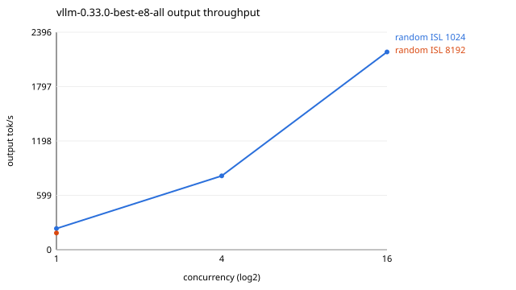

# Run report: `20261111T201822Z-vllm-0.33.0-best-e8-all-rtx-pro-6000-sex1-deccf806-ca1f`

## Identity

- engine config: `vllm-0.33.0-best-e8-all` (vllm 0.33.0)
- config hash: `deccf80607ad`
- hardware: `RTX-PRO-6000-SEx1`; exact article hardware: **True**
- GPU: NVIDIA RTX PRO 6000 Blackwell Server Edition / power limit 600.00 W / driver 610.57.04
- git: `None` dirty=None
- point-runs: 4 total, 4 valid

<details><summary>server argv</summary>

```
vllm serve google/gemma-4-12B-it --revision 43c9d014b231474fa7212dbb48a762566c2b255d --tensor-parallel-size 1 --dtype bfloat16 --gpu-memory-utilization 0.90 --no-enable-prefix-caching --async-scheduling --speculative-config {"method":"mtp","model":"google/gemma-4-12B-it-assistant","revision":"3b0b0a4a3b31b5556516329227fb55f275c23c9f","num_speculative_tokens":6,"num_speculative_tokens_per_batch_size":[[1,32,6],[33,4096,4]],"use_local_argmax_reduction":true} --max-num-batched-tokens 3072 --host 0.0.0.0 --port 8000
```
</details>

## Throughput vs concurrency

Mean over valid seeds/trials in this run; CI = Student-t 95 % across runs (needs n ≥ 2). Little's-law column is a within-run diagnostic from per-request logs.

| dataset | ISL | conc | n | output tok/s | 95% CI | tok/s/user | Little's-law tok/s (gap) |
|---|---:|---:|---:|---:|---|---:|---|
| random | 1024 | 1 | 1 | 233.6 | n<2 | 238.4 | 233.7 (+0.0%) |
| random | 1024 | 4 | 1 | 814.1 | n<2 | 215.1 | 835.6 (+2.6%) |
| random | 1024 | 16 | 1 | 2178 | n<2 | 149.4 | 2317 (+6.4%) |
| random | 8192 | 1 | 1 | 184.6 | n<2 | 209.3 | 184.6 (+0.0%) |



## Latency (ms, mean over runs of each run's statistic)

| dataset | ISL | conc | TTFT mean | TTFT p90 | TTFT p99 | TPOT mean | TPOT p99 | E2EL mean | E2EL p99 |
|---|---:|---:|---:|---:|---:|---:|---:|---:|---:|
| random | 1024 | 1 | 89.75 | 99.26 | 100.2 | 4.195 | 4.606 | 4007 | 4510 |
| random | 1024 | 4 | 132.3 | 165.5 | 275.2 | 4.649 | 5.652 | 4364 | 5341 |
| random | 1024 | 16 | 212.5 | 271.6 | 1083 | 6.691 | 8.58 | 6392 | 7829 |
| random | 8192 | 1 | 629.9 | 668.2 | 707.5 | 4.779 | 7.259 | 5085 | 6815 |

## Speculative decoding acceptance & resources

| dataset | ISL | conc | acceptance length | peak GPU MiB | mean GPU W |
|---|---:|---:|---:|---:|---:|
| random | 1024 | 1 | 5.205 | 86173 | 271 |
| random | 1024 | 4 | 5.143 | 86567 | 323 |
| random | 1024 | 16 | 5.145 | 86747 | 408 |
| random | 8192 | 1 | 4.768 | 86747 | 307 |

## Effective engine configuration (parsed from server logs)

| attention backend | spec algorithm | KV-cache tokens | max running requests | seen in |
|---|---|---:|---:|---|
| AttentionBackendEnum.TRITON_ATTN | not measured | 2,357,394 | not measured | 4 point-run(s) |

## Comparison with article baselines

Config role: **variant**, admissibility class **b** (DECISIONS D-011). Variants are not compared with the article's open baselines.
Variant run: see `g4bench analyze` (results/summary/comparison.csv) for the comparison with Backboard's reported numbers, labelled by admissibility class.

## Gap attribution (first-order; acceptance vs step speed)

Not computed: needs exact article hardware and a vLLM/SGLang run.

## Correctness gate

Known-answer probes: 8/8 — PASS; greedy outputs captured: 8

## Invalid / skipped point-runs

None.
