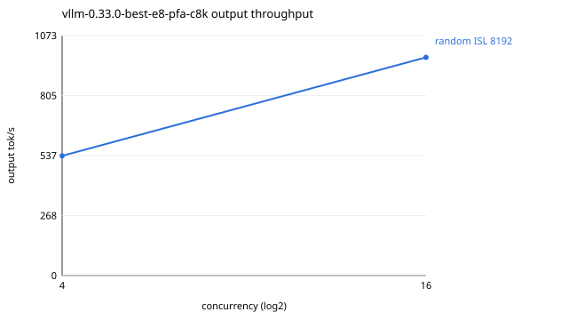

# Run report: `20261111T212427Z-vllm-0.33.0-best-e8-pfa-c8k-rtx-pro-6000-sex1-6fd46fcb-684f`

## Identity

- engine config: `vllm-0.33.0-best-e8-pfa-c8k` (vllm 0.33.0)
- config hash: `6fd46fcbd45a`
- hardware: `RTX-PRO-6000-SEx1`; exact article hardware: **True**
- GPU: NVIDIA RTX PRO 6000 Blackwell Server Edition / power limit 600.00 W / driver 610.57.04
- git: `None` dirty=None
- point-runs: 2 total, 2 valid

<details><summary>server argv</summary>

```
vllm serve google/gemma-4-12B-it --revision 43c9d014b231474fa7212dbb48a762566c2b255d --tensor-parallel-size 1 --dtype bfloat16 --gpu-memory-utilization 0.90 --no-enable-prefix-caching --async-scheduling --speculative-config {"method":"mtp","model":"google/gemma-4-12B-it-assistant","revision":"3b0b0a4a3b31b5556516329227fb55f275c23c9f","num_speculative_tokens":6,"num_speculative_tokens_per_batch_size":[[1,32,6],[33,4096,4]],"use_local_argmax_reduction":true} --max-num-batched-tokens 8192 --host 0.0.0.0 --port 8000
```
</details>

## Throughput vs concurrency

Mean over valid seeds/trials in this run; CI = Student-t 95 % across runs (needs n ≥ 2). Little's-law column is a within-run diagnostic from per-request logs.

| dataset | ISL | conc | n | output tok/s | 95% CI | tok/s/user | Little's-law tok/s (gap) |
|---|---:|---:|---:|---:|---|---:|---|
| random | 8192 | 4 | 1 | 535.3 | n<2 | 151.6 | 541.7 (+1.2%) |
| random | 8192 | 16 | 1 | 975.7 | n<2 | 66.99 | 990.4 (+1.5%) |



## Latency (ms, mean over runs of each run's statistic)

| dataset | ISL | conc | TTFT mean | TTFT p90 | TTFT p99 | TPOT mean | TPOT p99 | E2EL mean | E2EL p99 |
|---|---:|---:|---:|---:|---:|---:|---:|---:|---:|
| random | 8192 | 4 | 733.4 | 1144 | 2018 | 6.596 | 10.46 | 6801 | 1.038e+04 |
| random | 8192 | 16 | 1144 | 1261 | 7998 | 14.93 | 25.05 | 1.484e+04 | 2.45e+04 |

## Speculative decoding acceptance & resources

| dataset | ISL | conc | acceptance length | peak GPU MiB | mean GPU W |
|---|---:|---:|---:|---:|---:|
| random | 8192 | 4 | 4.695 | 89228 | 397 |
| random | 8192 | 16 | 4.890 | 89228 | 520 |

## Effective engine configuration (parsed from server logs)

| attention backend | spec algorithm | KV-cache tokens | max running requests | seen in |
|---|---|---:|---:|---|
| AttentionBackendEnum.TRITON_ATTN | not measured | 1,562,917 | not measured | 2 point-run(s) |

## Comparison with article baselines

Config role: **variant**, admissibility class **b** (DECISIONS D-011). Variants are not compared with the article's open baselines.
Variant run: see `g4bench analyze` (results/summary/comparison.csv) for the comparison with Backboard's reported numbers, labelled by admissibility class.

## Gap attribution (first-order; acceptance vs step speed)

Not computed: needs exact article hardware and a vLLM/SGLang run.

## Correctness gate

Known-answer probes: 8/8 — PASS; greedy outputs captured: 8

## Invalid / skipped point-runs

None.
