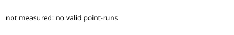

# Run report: `20261113T172740Z-vllm-0.33.0-best-e8-all-rtx-pro-6000-sex1-deccf806-e3c7`

> **NOT MEASURED:** this run has no valid point-runs.

## Identity

- engine config: `vllm-0.33.0-best-e8-all` (vllm 0.33.0)
- config hash: `deccf80607ad`
- hardware: `RTX-PRO-6000-SEx1`; exact article hardware: **True**
- GPU: NVIDIA RTX PRO 6000 Blackwell Server Edition / power limit 600.00 W / driver 610.57.04
- git: `7ba7edeaccfa22cce7aa0ff3de88c2a087b143ac` dirty=True
- point-runs: 0 total, 0 valid

<details><summary>server argv</summary>

```
vllm serve google/gemma-4-12B-it --revision 43c9d014b231474fa7212dbb48a762566c2b255d --tensor-parallel-size 1 --dtype bfloat16 --gpu-memory-utilization 0.90 --no-enable-prefix-caching --async-scheduling --speculative-config {"method":"mtp","model":"google/gemma-4-12B-it-assistant","revision":"3b0b0a4a3b31b5556516329227fb55f275c23c9f","num_speculative_tokens":6,"num_speculative_tokens_per_batch_size":[[1,32,6],[33,4096,4]],"use_local_argmax_reduction":true} --max-num-batched-tokens 3072 --host 0.0.0.0 --port 8000
```
</details>

## Throughput vs concurrency

Mean over valid seeds/trials in this run; CI = Student-t 95 % across runs (needs n ≥ 2). Little's-law column is a within-run diagnostic from per-request logs.

| dataset | ISL | conc | n | output tok/s | 95% CI | tok/s/user | Little's-law tok/s (gap) |
|---|---:|---:|---:|---:|---|---:|---|
| – | – | – | 0 | not measured | – | not measured | not measured |



## Latency (ms, mean over runs of each run's statistic)

| dataset | ISL | conc | TTFT mean | TTFT p90 | TTFT p99 | TPOT mean | TPOT p99 | E2EL mean | E2EL p99 |
|---|---:|---:|---:|---:|---:|---:|---:|---:|---:|

## Speculative decoding acceptance & resources

| dataset | ISL | conc | acceptance length | peak GPU MiB | mean GPU W |
|---|---:|---:|---:|---:|---:|

## Effective engine configuration (parsed from server logs)

| attention backend | spec algorithm | KV-cache tokens | max running requests | seen in |
|---|---|---:|---:|---|
| not measured | not measured | not measured | not measured | – |

## Comparison with article baselines

Config role: **variant**, admissibility class **b** (DECISIONS D-011). Variants are not compared with the article's open baselines.
Variant run: see `g4bench analyze` (results/summary/comparison.csv) for the comparison with Backboard's reported numbers, labelled by admissibility class.

## Gap attribution (first-order; acceptance vs step speed)

Not computed: needs exact article hardware and a vLLM/SGLang run.

## Correctness gate

Known-answer probes: 8/8 — PASS
Greedy capture: 8 prompts (set b17f5663089c, 256 max tokens, 12.92 s)
greedy equivalence: FAIL 4/8 identical; 4 divergent (4 near-tie <= 0.25 nats, 0 not, 0 unknown), 0 length, 0 error; identical-prefix tokens 0.794

## Invalid / skipped point-runs

None.
