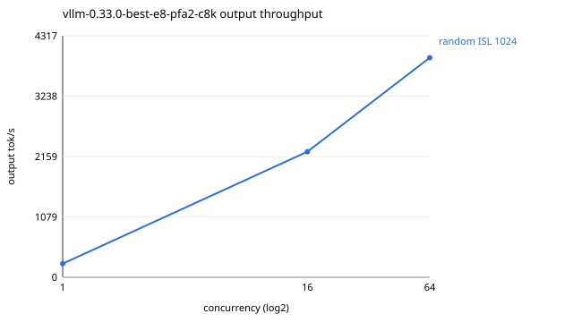

# Run report: `20261113T202830Z-vllm-0.33.0-best-e8-pfa2-c8k-rtx-pro-6000-sex1-cf0d6fd1-2eb6`

## Identity

- engine config: `vllm-0.33.0-best-e8-pfa2-c8k` (vllm 0.33.0)
- config hash: `cf0d6fd16b87`
- hardware: `RTX-PRO-6000-SEx1`; exact article hardware: **True**
- GPU: NVIDIA RTX PRO 6000 Blackwell Server Edition / power limit 600.00 W / driver 610.57.04
- git: `7e366956bf1a429828226f74a851943ec41ad067` dirty=True
- point-runs: 3 total, 3 valid

<details><summary>server argv</summary>

```
vllm serve google/gemma-4-12B-it --revision 43c9d014b231474fa7212dbb48a762566c2b255d --tensor-parallel-size 1 --dtype bfloat16 --gpu-memory-utilization 0.90 --no-enable-prefix-caching --async-scheduling --speculative-config {"method":"mtp","model":"google/gemma-4-12B-it-assistant","revision":"3b0b0a4a3b31b5556516329227fb55f275c23c9f","num_speculative_tokens":6,"num_speculative_tokens_per_batch_size":[[1,32,6],[33,4096,4]],"use_local_argmax_reduction":true} --max-num-batched-tokens 8192 --host 0.0.0.0 --port 8000
```
</details>

## Throughput vs concurrency

Mean over valid seeds/trials in this run; CI = Student-t 95 % across runs (needs n ≥ 2). Little's-law column is a within-run diagnostic from per-request logs.

| dataset | ISL | conc | n | output tok/s | 95% CI | tok/s/user | Little's-law tok/s (gap) |
|---|---:|---:|---:|---:|---|---:|---|
| random | 1024 | 1 | 1 | 243.3 | n<2 | 249 | 243.3 (+0.0%) |
| random | 1024 | 16 | 1 | 2245 | n<2 | 149.4 | 2312 (+3.0%) |
| random | 1024 | 64 | 1 | 3925 | n<2 | 64.8 | 4013 (+2.3%) |



## Latency (ms, mean over runs of each run's statistic)

| dataset | ISL | conc | TTFT mean | TTFT p90 | TTFT p99 | TPOT mean | TPOT p99 | E2EL mean | E2EL p99 |
|---|---:|---:|---:|---:|---:|---:|---:|---:|---:|
| random | 1024 | 1 | 88 | 96.4 | 96.53 | 4.017 | 4.313 | 3786 | 4336 |
| random | 1024 | 16 | 216.9 | 295.4 | 955.8 | 6.695 | 8.254 | 6345 | 7835 |
| random | 1024 | 64 | 489.7 | 599.5 | 3803 | 15.43 | 18.95 | 1.47e+04 | 1.938e+04 |

## Speculative decoding acceptance & resources

| dataset | ISL | conc | acceptance length | peak GPU MiB | mean GPU W |
|---|---:|---:|---:|---:|---:|
| random | 1024 | 1 | 5.440 | 89232 | 266 |
| random | 1024 | 16 | 5.131 | 89234 | 368 |
| random | 1024 | 64 | 4.201 | 89234 | 495 |

## Effective engine configuration (parsed from server logs)

| attention backend | spec algorithm | KV-cache tokens | max running requests | seen in |
|---|---|---:|---:|---|
| AttentionBackendEnum.TRITON_ATTN | not measured | 1,562,917 | not measured | 3 point-run(s) |

## Comparison with article baselines

Config role: **variant**, admissibility class **b** (DECISIONS D-011). Variants are not compared with the article's open baselines.
Variant run: see `g4bench analyze` (results/summary/comparison.csv) for the comparison with Backboard's reported numbers, labelled by admissibility class.

## Gap attribution (first-order; acceptance vs step speed)

Not computed: needs exact article hardware and a vLLM/SGLang run.

## Correctness gate

Known-answer probes: 8/8 — PASS
Greedy capture: 8 prompts (set b17f5663089c, 256 max tokens, 11.64 s)
greedy equivalence: FAIL 4/8 identical; 4 divergent (4 near-tie <= 0.25 nats, 0 not, 0 unknown), 0 length, 0 error; identical-prefix tokens 0.8935

## Invalid / skipped point-runs

None.
