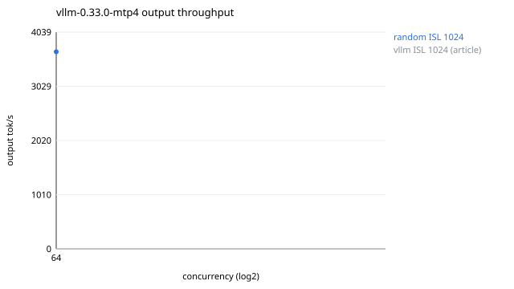

# Run report: `20261114T014002Z-vllm-0.33.0-mtp4-rtx-pro-6000-sex1-daa26a1c-d0be`

## Identity

- engine config: `vllm-0.33.0-mtp4` (vllm 0.33.0)
- config hash: `daa26a1c4df5`
- hardware: `RTX-PRO-6000-SEx1`; exact article hardware: **True**
- GPU: NVIDIA RTX PRO 6000 Blackwell Server Edition / power limit 600.00 W / driver 610.57.04
- git: `7d8d4bce8a0ebeac400fb39a2cfa2642e289d0a4` dirty=True
- point-runs: 1 total, 1 valid

<details><summary>server argv</summary>

```
vllm serve google/gemma-4-12B-it --revision 43c9d014b231474fa7212dbb48a762566c2b255d --tensor-parallel-size 1 --dtype bfloat16 --gpu-memory-utilization 0.90 --no-enable-prefix-caching --async-scheduling --speculative-config {"method":"mtp","model":"google/gemma-4-12B-it-assistant","revision":"3b0b0a4a3b31b5556516329227fb55f275c23c9f","num_speculative_tokens":4} --host 0.0.0.0 --port 8000
```
</details>

## Throughput vs concurrency

Mean over valid seeds/trials in this run; CI = Student-t 95 % across runs (needs n ≥ 2). Little's-law column is a within-run diagnostic from per-request logs.

| dataset | ISL | conc | n | output tok/s | 95% CI | tok/s/user | Little's-law tok/s (gap) |
|---|---:|---:|---:|---:|---|---:|---|
| random | 1024 | 64 | 1 | 3672 | n<2 | 60.67 | 3756 (+2.3%) |



## Latency (ms, mean over runs of each run's statistic)

| dataset | ISL | conc | TTFT mean | TTFT p90 | TTFT p99 | TPOT mean | TPOT p99 | E2EL mean | E2EL p99 |
|---|---:|---:|---:|---:|---:|---:|---:|---:|---:|
| random | 1024 | 64 | 527 | 686.5 | 4167 | 16.48 | 19.6 | 1.571e+04 | 2.057e+04 |

## Speculative decoding acceptance & resources

| dataset | ISL | conc | acceptance length | peak GPU MiB | mean GPU W |
|---|---:|---:|---:|---:|---:|
| random | 1024 | 64 | 4.195 | 87098 | 524 |

## Effective engine configuration (parsed from server logs)

| attention backend | spec algorithm | KV-cache tokens | max running requests | seen in |
|---|---|---:|---:|---|
| AttentionBackendEnum.TRITON_ATTN | not measured | 1,568,055 | not measured | 1 point-run(s) |

## Comparison with article baselines

Config role: **baseline**, admissibility class **a** (DECISIONS D-011).
Reference: article `vllm` (and Backboard) numbers for random-token prompts. Classification uses the pre-registered 5 % tolerance (docs/EXPERIMENTS.md); n<3 results are descriptive only.

| ISL | conc | ours | n | article vllm | ours/article | class | article Backboard | ours/Backboard |
|---:|---:|---:|---:|---:|---:|---|---:|---:|
| 1024 | 64 | 3672 | 1 | 3634 | 1.010 | consistent | 3822 | 0.961 |

## Gap attribution (first-order; acceptance vs step speed)

Assumptions: first-order: TPOT = step/AL; mean TPOT; AL incl. bonus token; batch = conc; ctx = ISL + OSL/2; roofline at 85% of peak HBM/GDDR bandwidth. Article mean TPOT = 1000 / its 'speed per user'.

| ISL | conc | our TPOT ms | our AL | step ms | BW eff. | AL needed for article vllm | for Backboard | step speed-up needed (Backboard) |
|---:|---:|---:|---:|---:|---:|---:|---:|---:|
| 1024 | 64 | 16.5 | 4.2 | 69.1 | 0.52 | 4.11 | 4.35 | 1.04x |

## Correctness gate

Known-answer probes: 8/8 — PASS
Greedy capture: 8 prompts (set b17f5663089c, 256 max tokens, 13.58 s)
greedy equivalence: FAIL 4/8 identical; 4 divergent (4 near-tie <= 0.25 nats, 0 not, 0 unknown), 0 length, 0 error; identical-prefix tokens 0.7174

## Invalid / skipped point-runs

None.
